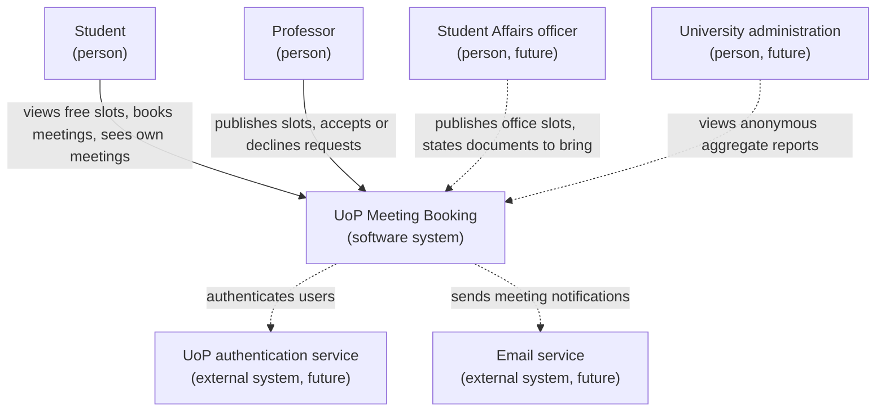
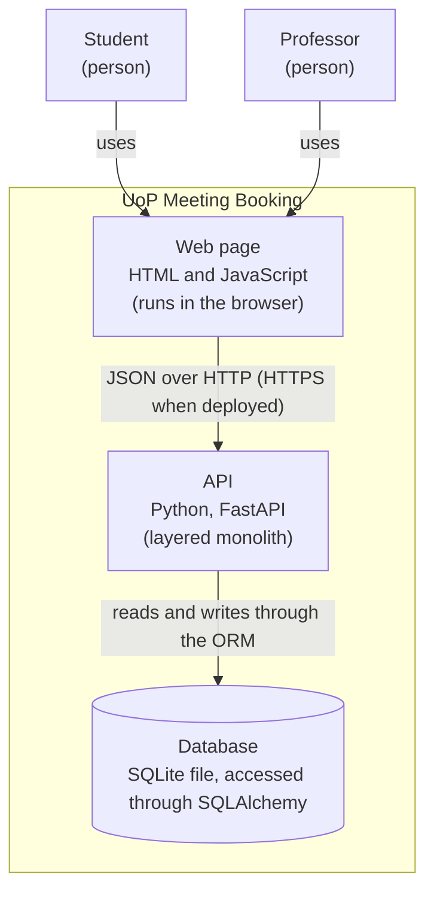

# System context diagram

Solid lines show what exists in the current release. Dotted lines show users and external systems planned for the target product.

# Container diagram
 
The system is deployed as a single application. SQLite is not a separate server: it is a file that the API opens directly. Because the database is accessed through SQLAlchemy, it can be replaced by a database server such as PostgreSQL by changing `DATABASE_URL`.
 

