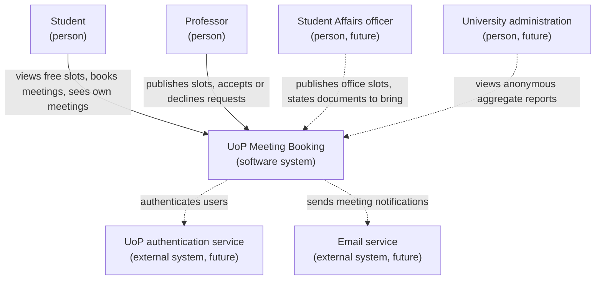
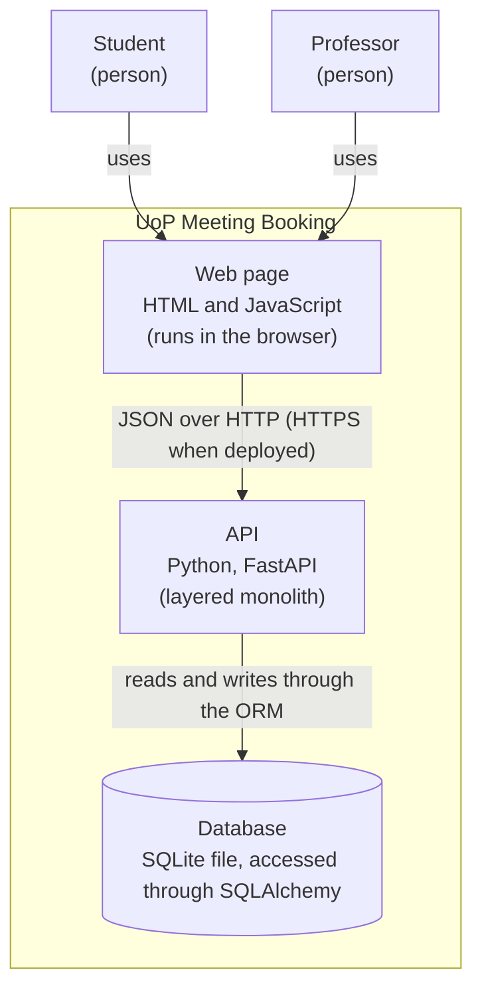

# System context diagram

Solid lines show what exists in the current release. Dotted lines show users and external systems planned for the target product.

# Container diagram

The system is deployed as a single application. SQLite is not a separate server: it is a file that the API opens directly. Because the database is accessed through SQLAlchemy, it can be replaced by a database server such as PostgreSQL by changing `DATABASE_URL`.

| Component         | Responsibility                                                                                                                                                   | Does not                                                                                              |
| ----------------- | ---------------------------------------------------------------------------------------------------------------------------------------------------------------- | ----------------------------------------------------------------------------------------------------- |
| Web page          | Shows slots and meetings, collects what the user enters, sends requests to the API and displays the results or errors.                                           | Apply business rules, store data or access the database. It never decides whether a booking is valid. |
| API layer         | Receives HTTP requests, validates their format with the schemas, calls the service layer and translates its results and domain errors into HTTP status codes.    | Apply business rules, such as whether a slot is free or a professor exists.                           |
| Service layer     | Applies the business rules (for example, that the professor exists or that a slot has at most one active meeting), checking and recording in the same operation. | Know anything about HTTP, or query the database directly; it uses the data access layer.              |
| Data access layer | Reads and writes professors, slots and meetings through SQLAlchemy.                                                                                              | Decide anything: it contains no business rules and no HTTP logic.                                     |
| Database          | Stores the data and enforces integrity constraints (required fields, unique emails, foreign keys).                                                               | Apply business rules or produce HTTP responses.                                                       | # Software Engineering, Week 4: Architecture Document (D4) |

**Author:** Eduardo Ion Bocos Varvari

**Project:** UoP Meeting Booking

[TO WRITE: two or three sentences introducing the document: what it describes and which deliverables it builds on (D1 vision, D3 requirements).]

## 1. Quality attributes

[TO WRITE: the three prioritised quality attributes (security, usability, maintainability), one justification each, and one sentence on what is not prioritised (performance and scalability, because the system targets a single department).]

## 2. System context

Solid lines show what exists in the current release. Dotted lines show users and external systems planned for the target product.

## 3. Containers

The system is deployed as a single application. SQLite is not a separate server: it is a file that the API opens directly. Because the database is accessed through SQLAlchemy, it can be replaced by a database server such as PostgreSQL by changing `DATABASE_URL`.

## 4. Components of the API

[TO WRITE on Saturday, after the skeleton: component diagram of the three layers and their modules.]

## 5. Responsibilities of major components

| Component         | Responsibility                                                                                                                                                   | Does not                                                                                              |
| ----------------- | ---------------------------------------------------------------------------------------------------------------------------------------------------------------- | ----------------------------------------------------------------------------------------------------- |
| Web page          | Shows slots and meetings, collects what the user enters, sends requests to the API and displays the results or errors.                                           | Apply business rules, store data or access the database. It never decides whether a booking is valid. |
| API layer         | Receives HTTP requests, validates their format with the schemas, calls the service layer and translates its results and domain errors into HTTP status codes.    | Apply business rules, such as whether a slot is free or a professor exists.                           |
| Service layer     | Applies the business rules (for example, that the professor exists or that a slot has at most one active meeting), checking and recording in the same operation. | Know anything about HTTP, or query the database directly; it uses the data access layer.              |
| Data access layer | Reads and writes professors, slots and meetings through SQLAlchemy.                                                                                              | Decide anything: it contains no business rules and no HTTP logic.                                     |
| Database          | Stores the data and enforces integrity constraints (required fields, unique emails, foreign keys).                                                               | Apply business rules or produce HTTP responses.                                                       |

## 6. Principal data flows

[TO WRITE on Saturday: one or two flows through the layers, for example a student requesting a slot that is already taken.]

## 7. Important interfaces

The API follows a resource-oriented style: each path represents a resource (slots, meetings) and each HTTP method an action on it. In milestone M2, every endpoint except `/health` and `/auth/login` will require identification.

| Method | Path                     | Purpose                                                         | Main responses     | Status       |
| ------ | ------------------------ | --------------------------------------------------------------- | ------------------ | ------------ |
| GET    | `/health`                | Checks that the application is running.                         | 200                | Implemented  |
| POST   | `/slots`                 | Publishes a new slot for a professor (US1).                     | 201, 422           | Implemented  |
| GET    | `/slots`                 | Lists the published slots with their professor (US1, US2 v0.1). | 200                | Implemented  |
| GET    | `/slots?available=true`  | Lists only free future slots, ordered by start time (US2).      | 200, 401           | Planned (M2) |
| POST   | `/meetings`              | Requests a meeting in a slot (US3).                             | 201, 401, 409, 422 | Planned (M2) |
| POST   | `/meetings/{id}/accept`  | Accepts a requested meeting (US4).                              | 200, 401, 404, 409 | Planned (M2) |
| POST   | `/meetings/{id}/decline` | Declines a requested meeting (US4).                             | 200, 401, 404, 409 | Planned (M2) |
| GET    | `/meetings/me`           | Lists the meetings of the identified user (US5).                | 200, 401           | Planned (M2) |
| POST   | `/auth/login`            | Identifies a user (US16).                                       | 200, 401, 422      | Planned (M2) |

**Status codes:** 201 when something is created; 200 for other successful requests; 401 when the user is not identified; 404 when a resource does not exist or belongs to someone else (preferred to 403, so that the existence of other people's meetings is not revealed); 409 when valid data conflicts with the current state of the system; 422 when the data sent is invalid.

**Design choice for US4:** state changes are separate action endpoints (`/accept`, `/decline`) instead of a generic `PATCH /meetings/{id}` that changes the status. Each transition has its own rules (only a requested meeting can be accepted), and separate endpoints make those rules explicit. The cost is a less uniform interface than a single update endpoint.

## 8. Technologies

[TO WRITE: Python 3.12, FastAPI, SQLAlchemy over SQLite, pytest and ruff, plain HTML and JavaScript; one line each on why.]

## 9. Architecture Decision Records

### ADR-001: Layered monolith instead of microservices

**Status:** Accepted

**Context:** The system is developed by a single developer in about two months. It targets one department: around 5-10 professors and 300 students, with an expected peak of about 100 users arranging meetings on the same day. Users need quick and simple access to availability and meetings. The course explicitly asks to decide whether architectural techniques such as microservices are appropriate, rather than adopting them by default.

**Alternatives considered:**

1. **Microservices.** Discarded: deploying, connecting and monitoring several services over the network has a high cost in time and maintenance, and brings no benefit with one developer and a small, uniform load.
2. **Unstructured monolith** (all logic in the endpoints, as in the D2 prototype). Discarded: every part of the code can access the data directly, so business rules end up duplicated or bypassed. It would become hard to understand, test and maintain once meetings and their rules are added.
3. **Layered monolith.** A single deployable application, internally divided into an API layer, a service layer with the business rules, and a data access layer.

**Decision:** Layered monolith.

**Rationale:** It fits the size of the team and the expected load, keeps development, testing and deployment simple, and gives each business rule a single place in the code. This supports the quality attributes prioritised for the product: maintainability, security and usability.

**Consequences:**

- Positive: one codebase and one deployment; business rules can be tested without starting a server; checks such as who may see a meeting are applied in one place.
- Negative: parts of the system cannot be scaled or deployed independently, and a serious failure affects the whole application.
- Mitigation and review: because the layers keep responsibilities separate, a part could later be extracted into a service if needed. This decision should be revisited if the system is extended to the whole university or to other universities.

### ADR-002: Three layers inside the API

**Status:** Accepted

**Context:** In the D2 prototype, each endpoint mixes three responsibilities: handling the HTTP request and its status codes, applying business rules (for example, that the professor exists), and accessing the database. Milestone M2 adds meetings and several business rules (BR2, BR3, BR7). Some of them are needed in more than one place: the overlap check, for instance, is required when publishing a slot (BR4), when publishing several slots at once (US7) and when proposing a new time (BR5).

**Alternatives considered:**

1. **Keep all logic in the endpoints.** Discarded: rules would be duplicated across endpoints and could only be tested through HTTP requests.
2. **A separate validation layer in front of an action layer.** Discarded: checking a rule in one layer and recording the result in another opens a race condition, for example two simultaneous requests for the same slot (Scenario 2), where both pass the check before either is stored.
3. **Two layers:** the API on one side, and rules and database queries together on the other. Discarded: rules would remain mixed with queries and could not be tested or changed separately.
4. **Three layers:** an API layer (HTTP and schemas), a service layer (business rules, checking and recording in the same operation) and a data access layer (database queries).

**Decision:** Three layers inside the API. Each layer only calls the layer directly below it.

**Rationale:** Each business rule has a single place in the code, so it is applied consistently wherever it is needed. Checking and recording happen in the same operation, which protects the integrity of the data. The service layer raises domain errors (for example, "slot already taken") and the API layer translates them into HTTP status codes, which mirrors the two levels of acceptance criteria: business-level and technical.

**Consequences:**

- Positive: business rules can be tested by calling the services directly, without a server; changes to the database or to the API affect only one layer.
- Negative: more files and some pass-through code, which is noticeable while the API only has a few endpoints.
- Review: the cost is accepted because the number of rules grows in M2; if the product stayed this small, two layers would be enough.

### ADR-003: [Optional, see plan] User identification for US16
