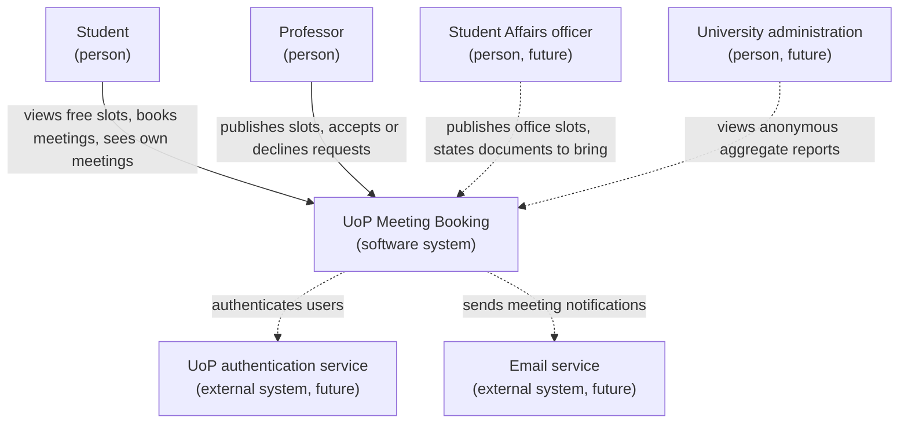
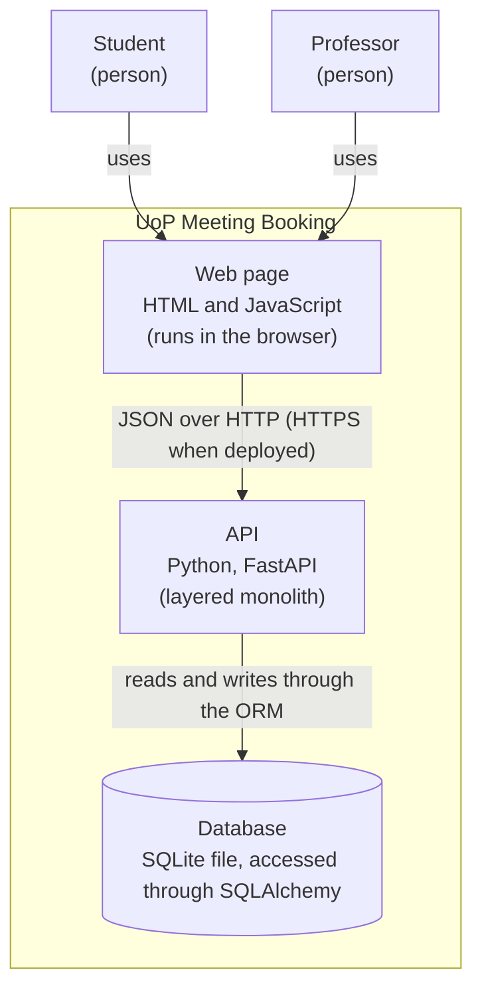
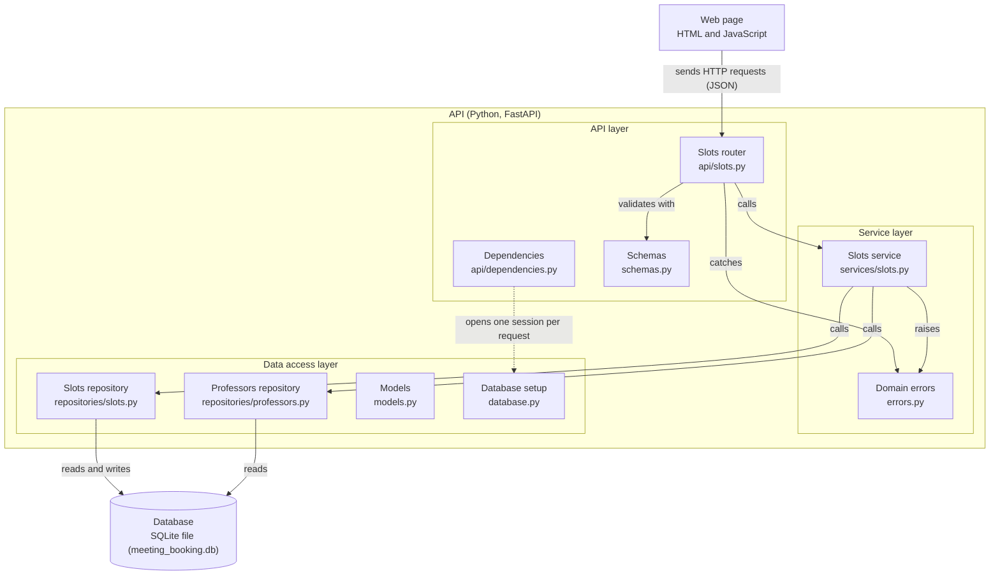

# Software Engineering, Week 4: Architecture Document (D4)

**Author:** Eduardo Ion Bocos Varvari

**Project:** UoP Meeting Booking

This document describes the architecture of UoP Meeting Booking. It builds on the vision (D1) and the requirements package (D3): it shows the system in its context, the containers and components that make it up, how data flows through them, and the main decisions behind this structure, recorded as Architecture Decision Records (ADRs).

## 1. Quality attributes

The requirements in D1 and D3 lead to three prioritised quality attributes, in this order:

1. **Security and privacy.** A meeting and its reason are visible only to the professor and the student involved. The architecture supports this by applying every access check in one place, the service layer (ADR-001), and by answering 404 instead of 403 for other people's meetings, so that their existence is not revealed (section 7).
2. **Maintainability.** The project has a single developer, so the code must be easy to read, change and debug. This is the main reason for the three layers (ADR-002) and for the automated tests and linter (section 8).
3. **Usability.** Students and professors of any role and technical level must be able to book or publish a slot without help. The web page is kept simple, and each domain error is translated into a clear message and status code.
   **Not prioritised:** performance and scalability. The system targets a single department, with an expected peak of about 100 users on the same day, so a single application with an SQLite database is enough (ADR-001).

## 2. System context

Solid lines show what exists in the current release. Dotted lines show users and external systems planned for the target product.

## 3. Containers

The system is deployed as a single application. SQLite is not a separate server: it is a file that the API opens directly. Because the database is accessed through SQLAlchemy, it can be replaced by a database server such as PostgreSQL by changing `DATABASE_URL`.

## 4. Components of the API

This diagram zooms into the API container. Each box is a module of the code, labelled with its file. Solid arrows are calls, and each layer only calls the layer directly below it. The dotted arrow is the only exception to this rule, explained in ADR-002: the API layer opens one database session per request and passes it down to the other layers.

## 5. Responsibilities of major components

| Component         | Responsibility                                                                                                                                                                                                   | Does not                                                                                              |
| ----------------- | ---------------------------------------------------------------------------------------------------------------------------------------------------------------------------------------------------------------- | ----------------------------------------------------------------------------------------------------- |
| Web page          | Shows slots and meetings, collects what the user enters, sends requests to the API and displays the results or errors.                                                                                           | Apply business rules, store data or access the database. It never decides whether a booking is valid. |
| API layer         | Receives HTTP requests, validates their format with the schemas, opens and closes one database session per request, calls the service layer and translates its results and domain errors into HTTP status codes. | Apply business rules, such as whether a slot is free or a professor exists.                           |
| Service layer     | Applies the business rules (for example, that the professor exists or that a slot has at most one active meeting), checking and recording in the same operation.                                                 | Know anything about HTTP, or query the database directly; it uses the data access layer.              |
| Data access layer | Reads and writes professors, slots and meetings through SQLAlchemy.                                                                                                                                              | Decide anything: it contains no business rules and no HTTP logic.                                     |
| Database          | Stores the data and enforces integrity constraints (required fields, unique emails, foreign keys).                                                                                                               | Apply business rules or produce HTTP responses.                                                       |

## 6. Principal data flows

The flows below follow `POST /slots`, the request a professor's web page sends to publish a slot.

### Flow 1: a professor publishes a slot (success)

1. The web page sends `POST /slots` with a JSON body: the professor, the start and end times, and the location.
2. Before running the endpoint, FastAPI validates the body against the `SlotCreate` schema and opens a database session through `get_db`.
3. The slots router calls the slots service with the validated data and the session.
4. The service asks the professors repository for the professor. The professor exists, so the service creates the slot and passes it to the slots repository, which adds it to the session.
5. The service commits the transaction, and the slot is stored.
6. The router returns the slot, shaped by the `SlotRead` schema, with status 201 Created. The session is closed.

### Flow 2: the professor does not exist (error)

Steps 1 to 3 are the same. In step 4, the professors repository returns `None`, so the service raises `ProfessorNotFoundError` and stops before creating the slot. The exception propagates up to the router, which catches it and returns 422 with the error message. Nothing is committed, so nothing is stored, and the session is closed.

### Invalid format

If the body is invalid (for example, a missing field, or an end time that is not after the start time), validation fails in step 2. FastAPI returns 422 and the service is never called.

In milestone M2, a student requesting a slot that is already taken (Scenario 2) will follow the same path as Flow 2: the service will raise a new domain error, which the router will translate into 409 Conflict.

## 7. Important interfaces

The API follows a resource-oriented style: each path represents a resource (slots, meetings) and each HTTP method an action on it. In milestone M2, every endpoint except `/health` and `/auth/login` will require identification.

| Method | Path                     | Purpose                                                         | Main responses     | Status       |
| ------ | ------------------------ | --------------------------------------------------------------- | ------------------ | ------------ |
| GET    | `/health`                | Checks that the application is running.                         | 200                | Implemented  |
| POST   | `/slots`                 | Publishes a new slot for a professor (US1).                     | 201, 422           | Implemented  |
| GET    | `/slots`                 | Lists the published slots with their professor (US1, US2 v0.1). | 200                | Implemented  |
| GET    | `/slots?available=true`  | Lists only free future slots, ordered by start time (US2).      | 200, 401           | Planned (M2) |
| POST   | `/meetings`              | Requests a meeting in a slot (US3).                             | 201, 401, 409, 422 | Planned (M2) |
| POST   | `/meetings/{id}/accept`  | Accepts a requested meeting (US4).                              | 200, 401, 404, 409 | Planned (M2) |
| POST   | `/meetings/{id}/decline` | Declines a requested meeting (US4).                             | 200, 401, 404, 409 | Planned (M2) |
| GET    | `/meetings/me`           | Lists the meetings of the identified user (US5).                | 200, 401           | Planned (M2) |
| POST   | `/auth/login`            | Identifies a user (US16).                                       | 200, 401, 422      | Planned (M2) |

**Status codes:** 201 when something is created; 200 for other successful requests; 401 when the user is not identified; 404 when a resource does not exist or belongs to someone else (preferred to 403, so that the existence of other people's meetings is not revealed); 409 when valid data conflicts with the current state of the system; 422 when the data sent is invalid.

**Design choice for US4:** state changes are separate action endpoints (`/accept`, `/decline`) instead of a generic `PATCH /meetings/{id}` that changes the status. Each transition has its own rules (only a requested meeting can be accepted), and separate endpoints make those rules explicit. The cost is a less uniform interface than a single update endpoint.

## 8. Technologies

The technologies were chosen so that a single developer can iterate quickly, keep the code easy to test and maintain, and avoid infrastructure the project does not need.

- **Python 3.12:** a widely used language with mature libraries for web APIs, databases and testing, which keeps the amount of code small.
- **FastAPI:** validates requests automatically against Pydantic schemas, generates interactive documentation at `/docs`, and provides dependency injection, which is used to open one database session per request and to replace the database in tests.
- **SQLite, accessed through SQLAlchemy:** SQLite stores the data in a single file and needs no database server. It is accessed through SQLAlchemy, as recommended by the professor, instead of Python's built-in `sqlite3` module. The ORM maps tables to Python classes, avoids writing SQL by hand, and allows a change to a database server such as PostgreSQL by changing `DATABASE_URL`.
- **pytest:** runs automated tests through the API against an in-memory database. The tests have already proved their value: when the code was refactored into layers, the existing tests passed without changes, which showed that the behaviour was preserved.
- **ruff:** a linter and formatter. It detects errors and style problems without running the code and keeps one consistent style; with a single developer and no code reviewer, it acts as a first automatic review. pytest and ruff will run in continuous integration (CI) in M2.
- **Plain HTML and JavaScript:** no framework and no build step, because the web page is small and the focus of the project is the API. Results are inserted with `textContent`, which prevents cross-site scripting.

## 9. Architecture Decision Records

### ADR-001: Layered monolith instead of microservices

**Status:** Accepted

**Context:** The system is developed by a single developer in about two months. It targets one department: around 5-10 professors and 300 students, with an expected peak of about 100 users arranging meetings on the same day. Users need quick and simple access to availability and meetings. The course explicitly asks to decide whether architectural techniques such as microservices are appropriate, rather than adopting them by default.

**Alternatives considered:**

1. **Microservices.** Discarded: deploying, connecting and monitoring several services over the network has a high cost in time and maintenance, and brings no benefit with one developer and a small, uniform load.
2. **Unstructured monolith** (all logic in the endpoints, as in the D2 prototype). Discarded: every part of the code can access the data directly, so business rules end up duplicated or bypassed. It would become hard to understand, test and maintain once meetings and their rules are added.
3. **Layered monolith.** A single deployable application, internally divided into an API layer, a service layer with the business rules, and a data access layer.
   **Decision:** Layered monolith.

**Rationale:** It fits the size of the team and the expected load, keeps development, testing and deployment simple, and gives each business rule a single place in the code. This supports the quality attributes prioritised for the product: maintainability, security and usability.

**Consequences:**

- Positive: one codebase and one deployment; business rules can be tested without starting a server; checks such as who may see a meeting are applied in one place.
- Negative: parts of the system cannot be scaled or deployed independently, and a serious failure affects the whole application.
- Mitigation and review: because the layers keep responsibilities separate, a part could later be extracted into a service if needed. This decision should be revisited if the system is extended to the whole university or to other universities.

### ADR-002: Three layers inside the API

**Status:** Accepted

**Context:** In the D2 prototype, each endpoint mixes three responsibilities: handling the HTTP request and its status codes, applying business rules (for example, that the professor exists), and accessing the database. Milestone M2 adds meetings and several business rules (BR2, BR3, BR7). Some of them are needed in more than one place: the overlap check, for instance, is required when publishing a slot (BR4), when publishing several slots at once (US7) and when proposing a new time (BR5).

**Alternatives considered:**

1. **Keep all logic in the endpoints.** Discarded: rules would be duplicated across endpoints and could only be tested through HTTP requests.
2. **A separate validation layer in front of an action layer.** Discarded: checking a rule in one layer and recording the result in another opens a race condition, for example two simultaneous requests for the same slot (Scenario 2), where both pass the check before either is stored.
3. **Two layers:** the API on one side, and rules and database queries together on the other. Discarded: rules would remain mixed with queries and could not be tested or changed separately.
4. **Three layers:** an API layer (HTTP and schemas), a service layer (business rules, checking and recording in the same operation) and a data access layer (database queries).
   **Decision:** Three layers inside the API. Each layer only calls the layer directly below it.

**Rationale:** Each business rule has a single place in the code, so it is applied consistently wherever it is needed. Checking and recording happen in the same operation, which protects the integrity of the data. The service layer raises domain errors (for example, "slot already taken") and the API layer translates them into HTTP status codes, which mirrors the two levels of acceptance criteria: business-level and technical.

**Consequences:**

- Positive: business rules can be tested by calling the services directly, without a server; changes to the database or to the API affect only one layer.
- Negative: more files and some pass-through code, which is noticeable while the API only has a few endpoints.
- Accepted exception: the API layer uses the data access layer directly in one place. It opens one database session per request (`get_db` in `database.py`), passes it to the service layer and closes it when the response is sent, but never queries with it. This is accepted because the lifetime of a session depends on the HTTP request, which only the API layer knows about, because all the services called in one request share one transaction, and because tests can replace the database with an in-memory one. Any other caller follows the same pattern: `seed.py`, which has no HTTP request, opens its own session.
- Review: the cost is accepted because the number of rules grows in M2; if the product stayed this small, two layers would be enough.
