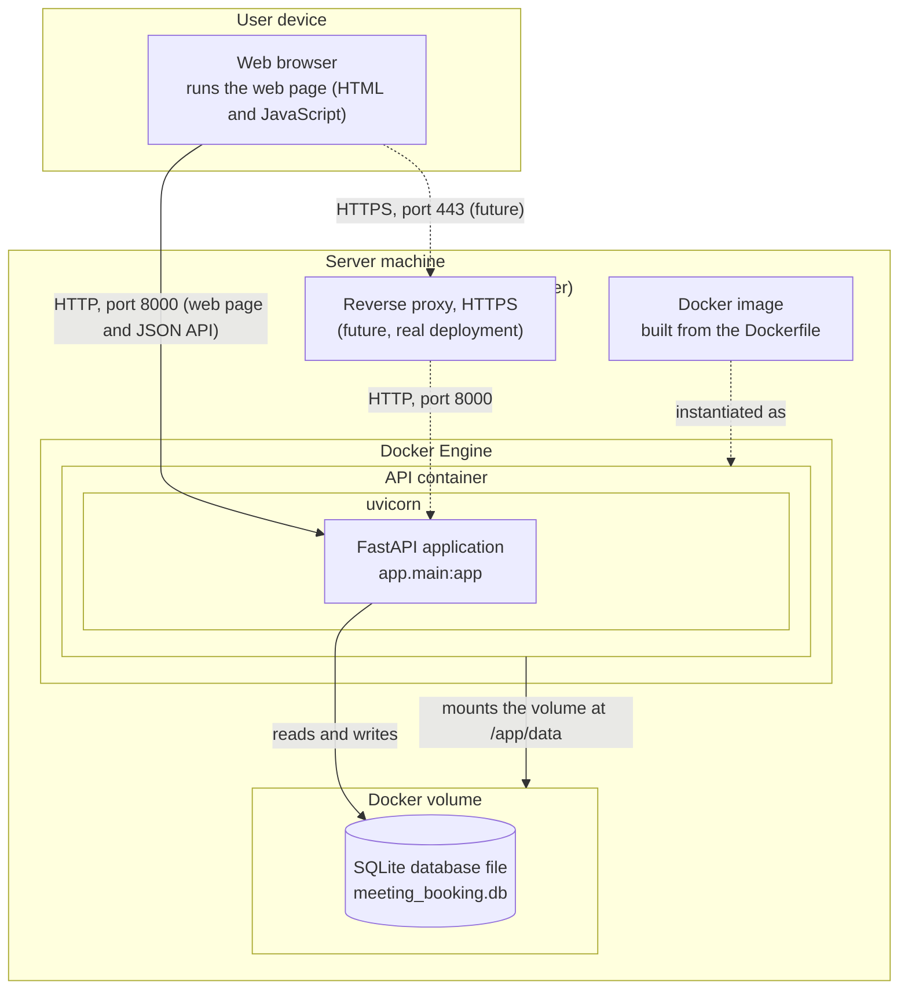

# Software Engineering, Week 5: Deployment Design (D5)

**Author:** Eduardo Ion Bocos Varvari

**Project:** UoP Meeting Booking

This document describes how UoP Meeting Booking is deployed and run. It builds on the architecture described in D4. The API runs in a Docker container on a single server machine, either the developer's laptop or a UoP server; no commercial cloud service is used. Docker was chosen because the application runs the same way on any machine, the deployment is described in a script (the Dockerfile) that can be reviewed and repeated, and a Docker volume keeps the data when the container is replaced.

## 1. Deployment diagram

- In this mermaid chart, we can see nested boxes, that basically means that the small box runs inside of the bigger one. For example: in the user device, runs the web browser.
- Also, notice that we have 2 different kinds of arrows:
  - Solid: already implemented.
  - dotted: planed for deployment.



## 2. Runtime components

| Component                            | Where it runs       | Responsibility                                                                                                    | Lifecycle                                                                                                         | State                                                                                              |
| ------------------------------------ | ------------------- | ----------------------------------------------------------------------------------------------------------------- | ----------------------------------------------------------------------------------------------------------------- | -------------------------------------------------------------------------------------------------- |
| Web browser                          | User device         | Displays the web page and sends HTTP requests to the API.                                                         | Starts when the user opens the page; independent of the server.                                                   | Temporary interface state only, lost when the page is reloaded.                                    |
| Docker Engine                        | Server machine      | Background service that builds images, creates, starts and stops containers, manages volumes and publishes ports. | Starts with the server machine. Restarts the API container automatically if it stops (restart policy).            | None of its own.                                                                                   |
| API container                        | Docker Engine       | Runs one instance of the Docker image, isolated from the rest of the machine.                                     | Created from the image at deployment; replaced by a new container at each new version.                            | Stateless: everything inside it is lost when it is removed.                                        |
| uvicorn                              | API container       | ASGI web server: listens on `0.0.0.0:8000`, receives HTTP requests and passes each one to the application.        | Starts and stops with the container.                                                                              | Stateless.                                                                                         |
| FastAPI application (`app.main:app`) | uvicorn             | Serves the web page and the JSON API; applies the business rules through the layers described in D4.              | Loaded once when uvicorn starts (it includes the routers and creates missing tables), then handles every request. | Stateless: it opens one database session per request and keeps nothing in memory between requests. |
| Docker volume                        | Server machine disk | Stores the SQLite database file outside the container.                                                            | Created once; persists until it is explicitly deleted, independently of any container.                            | Stateful: it holds all the persistent data.                                                        |
| Reverse proxy (planned)              | Server machine      | Receives HTTPS on port 443, decrypts it with the certificate and forwards plain HTTP to uvicorn.                  | Starts with the server machine.                                                                                   | Stateless (its certificates are configuration, not data).                                          |

## 3. Data-storage strategy

**What is stored.** The domain entities: professors and slots now, and meetings and users in milestone M2. User passwords will be stored hashed, never in plain text.

**Where.** The tables are defined in `models.py` and stored in a single SQLite file, `meeting_booking.db`. The file lives in a Docker volume, mounted inside the container at `/app/data`, so it survives when the container is replaced.

**How the application finds it.** The location is read from the `DATABASE_URL` environment variable, which is passed to the container when it starts (`sqlite:////app/data/meeting_booking.db`). The same code can therefore use another file, or an in-memory database in the tests, without changes.

**How it is accessed.** Through SQLAlchemy, with one session per request. Each operation is a single transaction committed by the service layer, so it is atomic: either all its changes are stored or none are.

**What is not stored on the server.** The application is stateless: it keeps no user data in memory between requests. Everything that must persist is in the database.

**Tables and schema changes.** At start-up, `Base.metadata.create_all` creates the tables that do not exist yet. It does not modify existing tables, so future changes to the schema (for example, adding a column) will need migrations, for instance with Alembic.

**Limitations.** SQLite allows only one writer at a time, and the file cannot be shared by several machines. Therefore only one instance of the API runs, and the system cannot scale horizontally. This is enough for the expected load of about 100 users on the busiest day (D4). If the system grew, the first step would be to move to a database server such as PostgreSQL.

## 4. Backup and failure handling**Backup policy:**

- **Frequency:** one backup every day, so at most one day of data can be lost (a recovery point objective, RPO, of 24 hours), plus an extra backup just before each deployment.
- **Method:** the SQLite `.backup` command, which produces a consistent copy even while the application is running. A plain file copy could capture the file half-written.
- **Retention:** the last 7 daily backups are kept.
- **Location:** on the server machine and, at least one copy, on another device (for example, a desktop computer or a UoP server), so that the data survives if the server machine's disk fails.
- **Testing:** restoring a backup is tested, because a backup that has never been restored cannot be trusted.
  Failures fall into two groups: availability failures, where the data is intact and the system only has to be restarted or rolled back, and data failures, where a backup must be restored.

| Scenario                                  | What happens                                                                                                                                         | Recovery                                                                                                                                                                  |
| ----------------------------------------- | ---------------------------------------------------------------------------------------------------------------------------------------------------- | ------------------------------------------------------------------------------------------------------------------------------------------------------------------------- |
| The application process crashes           | The container stops. Requests in progress fail; anything not yet committed is discarded, and atomicity guarantees that no half-written data remains. | Docker restarts the container automatically (restart policy `unless-stopped`). Recovery takes seconds and no committed data is lost.                                      |
| A new version has a bug                   | `/health` fails after deployment, or users report errors.                                                                                            | Roll back: stop the new container and start the previous image version again. If the new version wrote incorrect data, restore the copy taken just before the deployment. |
| The server machine shuts down             | The system is unavailable; browsers receive connection errors and those requests are lost. The data remains intact in the volume.                    | When the machine starts again, Docker Engine starts and the restart policy brings the container back. This single point of failure is accepted in ADR-001.                |
| The database file is corrupted or deleted | The application cannot read or write data.                                                                                                           | Stop the container, replace the file in the volume with the latest backup and start the container again. Data written since that backup is lost (at most 24 hours).       |

## 5. Deployment process

1. **Run the tests.** Only a version that passes all the tests is deployed.
2. **Tag the version in git** (for example, `v0.2.0`). The tag marks exactly which code is deployed, so it can always be found again.
3. **Build the Docker image with the same tag** (for example, `uop-meeting-booking:0.2.0`). Each image corresponds to one commit, and the previous image stays available for a rollback. Steps 1 to 3 do not affect the running system.
4. **Stop and remove the old container.** From this point the system is unavailable, so the next steps must follow without delay.
5. **Back up the database.** Because the container is stopped, nothing is writing to the file, so the copy is consistent. If the new version damages the data, this copy restores it.
6. **Start the new container,** with port 8000 published, the volume mounted at `/app/data`, the `DATABASE_URL` variable and the restart policy `unless-stopped`.
7. **Check `/health`.** It confirms that the API has started and responds.
8. **If the check fails, roll back first and investigate afterwards:** stop the new container, start the previous image again and, if needed, restore the backup from step 5. Users should not have to wait while the problem is investigated.

Dockerfile code:

```bash
docker build -t uop-meeting-booking:0.1.0 .
docker volume create uop-data
docker run -d --name uop-api -p 8000:8000 -v uop-data:/app/data -e DATABASE_URL=sqlite:////app/data/meeting_booking.db --restart unless-stopped uop-meeting-booking:0.1.0
curl http://localhost:8000/health
```

The persistence strategy was tested: after removing the container and starting a new one from the same image, the data created before was still available
